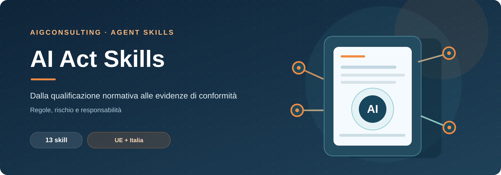
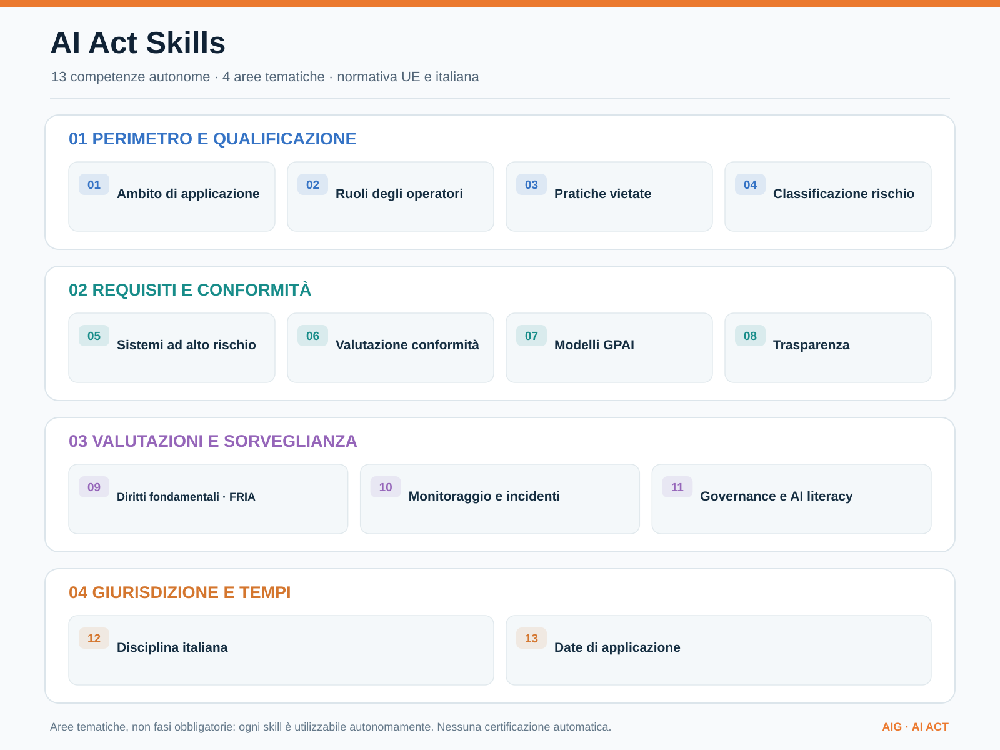

# AI Act Skills

Catalogo di 13 skill autonome per analisi documentale e normativa AI Act, con disciplina UE e italiana.

**Stato:** prima versione operativa documentale, non validazione giuridica né certificazione di conformità. Ogni skill può essere invocata indipendentemente.

## Skill disponibili

[Apri il diagramma vettoriale SVG](assets/ai-act-competencies.svg)

La mappa organizza **13 competenze autonome in quattro aree tematiche**: non rappresenta un workflow obbligatorio né una sequenza di adempimenti.

| Skill | Competenza |
| --- | --- |
| [`ai-act-scope`](ai-act-scope/SKILL.md) | Ambito di applicazione |
| [`ai-act-operator-roles`](ai-act-operator-roles/SKILL.md) | Ruoli e responsabilità degli operatori |
| [`ai-act-prohibited-practices`](ai-act-prohibited-practices/SKILL.md) | Pratiche vietate |
| [`ai-act-risk-classifier`](ai-act-risk-classifier/SKILL.md) | Classificazione del rischio |
| [`ai-act-high-risk-controls`](ai-act-high-risk-controls/SKILL.md) | Requisiti dei sistemi ad alto rischio |
| [`ai-act-conformity`](ai-act-conformity/SKILL.md) | Valutazione della conformità |
| [`ai-act-gpai`](ai-act-gpai/SKILL.md) | Modelli GPAI e rischio sistemico |
| [`ai-act-transparency`](ai-act-transparency/SKILL.md) | Obblighi di trasparenza |
| [`ai-act-fria`](ai-act-fria/SKILL.md) | Valutazione impatto sui diritti fondamentali |
| [`ai-act-monitoring-incidents`](ai-act-monitoring-incidents/SKILL.md) | Monitoraggio e incidenti AI |
| [`ai-act-governance`](ai-act-governance/SKILL.md) | Governance e alfabetizzazione AI |
| [`ai-act-italy`](ai-act-italy/SKILL.md) | Disciplina italiana AI |
| [`ai-act-deadlines`](ai-act-deadlines/SKILL.md) | Calendario di applicazione |

## Principi

1. Verificare sempre testo vigente, versione, data di applicazione, eventuali eccezioni e giurisdizione.
2. Citare fonti primarie, articoli, URL, data di consultazione e fatti probatori; non inventare citazioni.
3. Separare fatto verificato, dichiarazione del richiedente, ipotesi, lacuna, proposta e decisione autorizzata.
4. Non dichiarare conformità giuridica; richiedere valutazione professionale quando necessaria.
5. Nessun invio, notifica, accettazione, pubblicazione o modifica operativa senza esplicita autorizzazione.
6. La normativa italiana integra/specífica i regolamenti UE direttamente applicabili: non chiamarla trasposizione generalizzata.

## Fonti primarie

- [AI Act, testo consolidato EUR-Lex](https://eur-lex.europa.eu/eli/reg/2024/1689/2026-07-27/eng)
- [Legge italiana 132/2025, Normattiva](https://www.normattiva.it/eli/id/2025/09/25/25G00143/CONSOLIDATED)

## Utilizzo

Ogni cartella contiene `SKILL.md` in formato Agent Skills. Copiare la singola cartella nella directory skill del proprio client (es. `~/.claude/skills/`, `~/.config/opencode/skills/`, `.agents/skills/`). Le skill guidano la produzione di documenti: non eseguono azioni verso autorità o terzi.

## Progetto e limiti

La [scheda obiettivo](https://github.com/aigconsulting/ai-act-skills/issues/1) documenta perimetro e criteri di accettazione. Sono ancora da implementare test automatici, un catalogo HTTP/versionato, casi di prova E2E, integrazioni applicative e review giuridica. La presenza del file SKILL.md non certifica il risultato prodotto da un agente.
